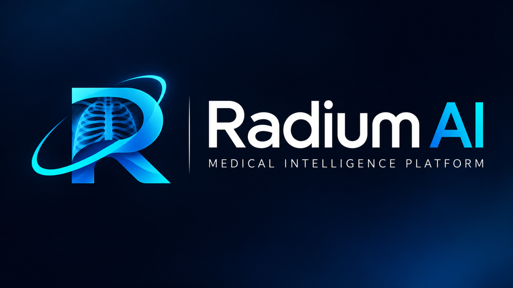
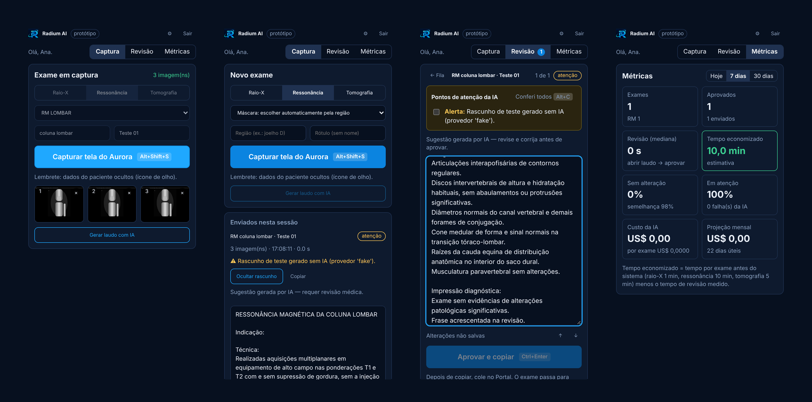
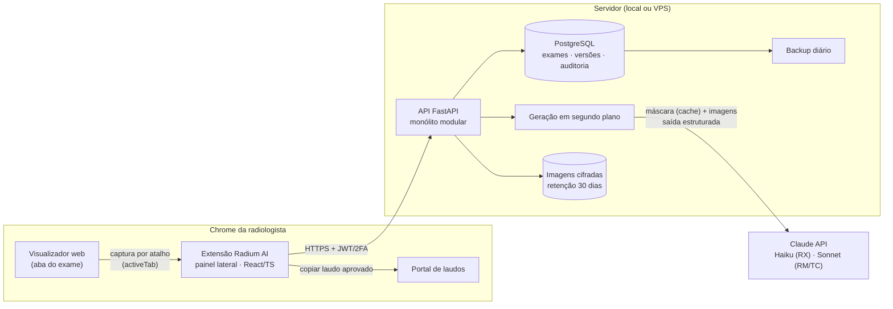

  

  <b>Assistente de laudos radiológicos com IA, do print manual ao laudo revisado em poucos segundos.</b> 
  Python · FastAPI · PostgreSQL · React · TypeScript · Chrome Extension (MV3) · Claude API · Docker

  
  
  
  

> **English summary** at the [end of this page](#english-summary).

---

## O problema

Uma radiologista lauda **cerca de 400 radiografias e 30 ressonâncias por dia** numa plataforma
de terceiros que **não permite exportar os exames**. O fluxo dela era:

1. abrir o exame no visualizador web;
2. tirar print de cada imagem e sequência;
3. colar os prints num chatbot genérico;
4. esperar, ajustar o texto ao padrão dela e copiar de volta para a plataforma.

Com cerca de 1 minuto por raio-X, a parte mecânica (print → chat → copiar) consome uma fração
grande do dia. E um chatbot genérico **não segue as máscaras de laudo dela** e pode descrever
como "normal" algo que nem aparece na imagem.

## A solução

Um sistema próprio, com IA aplicada de forma **controlada e auditável**, em que **a palavra final
é sempre da médica**.

  
   Painel lateral no Chrome: captura → rascunho → revisão → métricas (dados de demonstração).

| Etapa | Como funciona |
|---|---|
| **Captura** | Extensão do Chrome com painel lateral. Um atalho (`Alt+Shift+S` / `⌥⇧S`) captura a aba do visualizador, só se for o endereço configurado. As imagens vão cifradas para o servidor. |
| **Rascunho** | A IA preenche **as máscaras da própria radiologista**: frases padrão de normalidade, achados opcionais só se presentes, lacunas (nível, lado) e alternativas. Cada frase volta com origem (linha da máscara ou texto novo) e confiança. |
| **Revisão** | Fila com prioridade para casos "em atenção", editor com salvamento automático e histórico de versões. Os **pontos de atenção** da IA precisam ser conferidos antes de aprovar. `Ctrl+Enter` aprova, copia e abre o próximo. |
| **Métricas** | Tempo de revisão por exame, tempo economizado, % de rascunhos aprovados sem alteração, custo da IA por exame e projeção mensal. |

## Arquitetura

**Princípios:** monólito modular (uma pessoa mantém), provedores de IA intercambiáveis,
nenhuma automação sobre a plataforma de terceiros (só captura por ação da usuária) e
privacidade por padrão (dados do paciente ocultos antes da captura, imagens temporárias).

## Destaques de engenharia

### IA que não inventa: validação no servidor, não só no prompt
- **Saída estruturada estrita** (JSON Schema): cada frase traz seção, origem, linha da máscara e
  confiança, além de listas de "não avaliável" e alertas.
- **Parser das máscaras da médica**, num formato próprio: `*` para achado opcional, `**` para
  trecho opcional, `/` para alternativas, `XXXX`/`LX-LX` para lacunas, variantes de técnica.
- **Validações pós-IA** encontradas em testes reais e transformadas em regras:
  - frase de normalidade sobre estrutura que a própria IA marcou como não avaliável → **retirada**
    e convertida em alerta (caso real: "cone medular normal" com o cone fora dos cortes);
  - frase de normalidade que contradiz um alerta da IA → vira ponto de atenção;
  - linha de máscara inexistente → marcada como texto novo.
- **Teste de segurança**: uma imagem sintética enviada como "RM de coluna" foi recusada pelos
  modelos, com tudo marcado como não avaliável.

### Custo: de ~R$ 1.100 para ~R$ 110 por mês, medido
| Alavanca | Efeito medido |
|---|---|
| Modelo por modalidade: Haiku no raio-X (volume), Sonnet em RM/TC | ~12× mais barato no raio-X |
| Esforço de raciocínio baixo | −20% de custo e −30% de latência na RM, sem perda observada |
| **Prompt caching** da máscara + exemplos (parte estável antes das imagens) | −35% do 2º exame em diante (US$ 0,024 → 0,015) |
| Alertas só quando relevantes (prompt) | fim dos falsos "em atenção" |

Custo, tokens, latência, modelo e versão do prompt ficam registrados **por rascunho**.

### Fluxo pensado para 400 exames/dia
- Rascunho gerado em segundo plano enquanto ela captura o próximo exame.
- Tudo pelo teclado, com atalhos adaptados a Windows e Mac (inclui o caso `⌥C` → `ç` no Mac).
- **Contra a aprovação automática**: pontos de atenção precisam ser conferidos, e a
  similaridade entre rascunho e laudo final é registrada.

### Segurança e privacidade (dados de saúde, LGPD)
- Senha com Argon2, **2FA TOTP obrigatório** em produção, bloqueio por tentativas, anti-replay
  do código.
- Dados isolados por usuária (testado), sem cadastro público.
- Imagens **cifradas em disco** (Fernet) e apagadas após 30 dias; o laudo e o histórico ficam.
- Auditoria de login, capturas, geração, edição, aprovação e retenção.
- Produção: API só em `127.0.0.1` (local) ou atrás do Caddy com HTTPS/HSTS (VPS),
  `ALLOWED_HOSTS`, `no-store`, backup diário com rotação e restauração testada.

### Uma descoberta que virou decisão de arquitetura
`chrome.tabs.captureVisibleTab` **não aceita** a permissão do domínio específico: exige
`activeTab` ou `<all_urls>`. Testei em Chromium real e registrei uma ADR. Resultado: captura
padrão pelo **atalho de teclado** (sem permissão ampla) e captura por botão como opção explícita
da usuária.

## Qualidade

- **215 testes** na API (pytest + PostgreSQL real), incluindo **todas as combinações** de
  status × ator da máquina de estados e tentativas de acesso a dados de outra usuária.
- **29 testes** na extensão (Vitest).
- **Teste ponta a ponta em Chromium real** (Playwright) com um visualizador simulado: login,
  captura, envio (~130–230 ms), geração, revisão **só pelo teclado**, cópia e métricas
  (19 verificações).
- **CI** no GitHub Actions: lint (Ruff), migrações + `alembic check`, testes, typecheck, build
  da extensão e da imagem Docker.
- Decisões registradas em **ADRs** ([resumo](docs/decisoes-tecnicas.md)).

## Stack

| Camada | Tecnologias |
|---|---|
| API | Python 3.12, FastAPI, SQLAlchemy 2, Alembic, Pydantic, uv |
| Banco | PostgreSQL 16 |
| IA | Claude API (Anthropic SDK): saída estruturada, prompt caching, fallback em recusas |
| Extensão | Chrome Manifest V3, React 18, TypeScript, Vite |
| Segurança | Argon2, JWT, TOTP (2FA), Fernet |
| Infra | Docker Compose, Caddy (HTTPS automático), GitHub Actions |
| Testes | pytest, Vitest, Playwright |

## Roadmap

- [x] Planejamento técnico, custos e riscos (LGPD, Anvisa RDC 657/2022)
- [x] API, autenticação com 2FA, máscaras, exames e auditoria
- [x] Extensão do Chrome com captura
- [x] Rascunho por IA a partir das máscaras, com validações e comparação às cegas de modelos
- [x] Revisão pelo teclado e métricas
- [x] Produção: local ou VPS, backup, retenção e revisão de segurança
- [ ] Piloto de 2 a 4 semanas com a radiologista (avaliação às cegas em andamento)
- [ ] Máscaras de raio-X e ressonância musculoesquelética
- [ ] Integração DICOM/DICOMweb, se autorizada, para analisar a ressonância completa

## Sobre o código

O código-fonte fica num **repositório privado**, porque o sistema está em uso real e lida com o
fluxo de trabalho de uma profissional de saúde. **Posso mostrar o código numa entrevista ou dar
acesso de leitura** a quem estiver avaliando meu trabalho: é só pedir.

Contato: [@teuzslima](https://github.com/teuzslima)

> ⚠️ Protótipo de apoio. Toda sugestão gerada por IA é revisada e aprovada pela radiologista
> responsável. O sistema não emite laudos de forma autônoma.

---

## English summary

**Radium AI** is an AI-assisted radiology reporting tool I designed and built for a radiologist
who reads ~400 X-rays and ~30 MRIs a day on a third-party platform that doesn't allow exports.

- **Chrome extension (MV3, React/TS)** captures the viewer tab with one shortcut, then drafts,
  reviews and copies the report. Everything is keyboard-driven.
- **FastAPI + PostgreSQL** backend with 2FA, per-user isolation, an exam state machine (only the
  physician can approve), report versioning, audit log and usage metrics.
- **Claude API with guardrails**: the model fills the physician's *own* report templates through
  strict structured output. Server-side checks remove "normal" statements about structures the
  model itself flagged as not assessable, and route uncertainty to a mandatory review checklist.
- **Cost engineering, measured**: model routing by modality, low reasoning effort and prompt
  caching cut the projected monthly AI cost from ~US$ 200 to ~US$ 20 (−35% from caching alone).
- **Quality**: 215 API tests, 29 extension tests, a real-Chromium E2E test (Playwright) and CI.
- **Production-ready**: Docker Compose for a local machine or a VPS (Caddy/HTTPS), daily
  backups with tested restore, 30-day image retention and a written security review.

Source code is private (real-world use, healthcare workflow) and **available on request** for
technical review.
